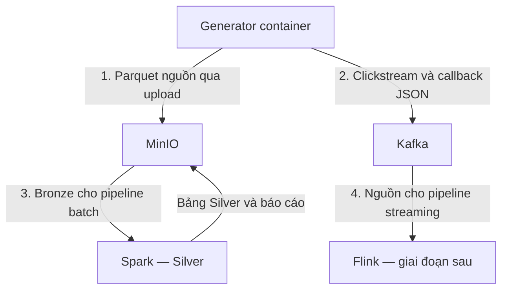

# EDAI — Generator dữ liệu thương mại điện tử tự sinh (Python 1.1.0)

**Sửa image storage ngày 21/10/2026:** service `minio` dùng PGSTY Silo (fork cộng đồng tương thích MinIO) vì image Quay cũ không còn tải công khai. Xem [cách sửa lỗi 401](docs/minio_image_fix.md).

**Bắt đầu tại [BAT_DAU_O_DAY.md](BAT_DAU_O_DAY.md).** File `generate_data.py` chạy ba bước: sinh bảng → kiểm tra → lập lịch sự kiện. Bản 1.1 thêm nguồn `customer_changes` cho SCD2 và profile `ml_history.json` cho lịch sử dài.

**Đã có dữ liệu trên storage?** Chạy [pipeline DP1: nguồn → Bronze](docs/pipeline_01_bronze.md).
Gói hiện có thêm module `pipelines.dp1_source_to_bronze`, dùng image generator hiện tại sau khi build lại.

**Đã hoàn tất Bronze?** Chạy [DP2a: Bronze → Silver bằng Spark](docs/pipeline_02_silver.md).
Overlay `compose.spark.yaml` bổ sung master, worker, driver và History Server.

Mã nguồn cho phần **Implement Data Generator** trong rubric `EDAI K11 - DE(1).xlsx`,
sheet `edai-1 (50%)`, các dòng 5–10. Toàn bộ bản ghi do Python sinh; không tải
Kaggle, không cào web, không cần dữ liệu đầu vào. Đây là phần nguồn dữ liệu của
đồ án, kèm DP1 và job Spark tạo Silver. Flink, Gold, Airflow, catalog lakehouse,
DataHub, Feast và các nền tảng AI được triển khai ở những giai đoạn tiếp theo.

## Mục lục

1. [Domain và luồng triển khai](#domain-và-luồng-triển-khai)
2. [Những gì mã nguồn thực hiện](#những-gì-mã-nguồn-thực-hiện)
3. [Cấu trúc repo](#cấu-trúc-repo)
4. [Chạy lần đầu trên Windows bằng Docker](#chạy-lần-đầu-trên-windows-bằng-docker)
5. [Sinh đủ 100GB và tiếp tục khi bị dừng](#sinh-đủ-100gb-và-tiếp-tục-khi-bị-dừng)
6. [Đọc code theo thứ tự](#đọc-code-theo-thứ-tự)
7. [Kiểm thử và phạm vi xác minh](#kiểm-thử-và-phạm-vi-xác-minh)
8. [Tài liệu chi tiết](#tài-liệu-chi-tiết)

## Domain và luồng triển khai

Mô phỏng một cửa hàng thương mại điện tử bán điện tử, thời trang và đồ gia dụng.
Khách hàng đặt đơn gồm nhiều sản phẩm; thanh toán có thể thất bại rồi thử lại.
Website/app phát sự kiện xem hàng, thêm giỏ hàng và đặt đơn. Cổng thanh toán phát
callback có thể bị gửi lại. Tên, thương hiệu và mô tả đều là dữ liệu giả lập.



Compose gốc có Generator, MinIO và Kafka; Spark được bổ sung bằng overlay riêng.
Flink ở bước sau. File Parquet ban đầu được ghi ra `output/`, sau đó `upload`
đưa chúng lên nguồn MinIO, DP1 tạo Bronze và Spark xử lý Silver.

## Những gì mã nguồn thực hiện

| Yêu cầu | Cách thực hiện | Bằng chứng sinh khi chạy |
|---|---|---|
| Offline tối thiểu 100GB | Profile `full_100gb.json`; dừng khi tổng file Parquet thực tế >= 100.000.000.000 byte | `manifest.json`: `physical_source_bytes`, `rubric_100gb_met` |
| Skew | Khoảng 80% đơn giao TP.HCM; 75% danh mục điện tử khi số sản phẩm chia hết cho 4 | Phân bố thực tế trong `evidence/validation.json` |
| Schema evolution | File `payments` v1 không có `failure_reason`; v2 thêm cột string nullable | Schema vật lý trước/sau trong manifest; validator đọc từng file |
| Vấn đề offline khác | Khoảng 2% tổng dòng cuối của `order_items` là bản sao; cùng ID, `created_ts` tăng 1 giây | Số ID unique, tỷ lệ duplicate, chênh lệch tổng tiền trước/sau khử trùng |
| Lưu nguồn để ingest Bronze | Upload vào bucket `source-department`, marker `_READY.json` ghi sau cùng | `evidence/upload_report.json` và các object MinIO |
| Late arrivals | Một phần clickstream mobile đến muộn 300–600 giây | `stream/plan_report.json`; replay thật qua Kafka |
| Vấn đề streaming khác | Khoảng 1,5% callback cuối là bản gửi lại, cùng event/payment ID và payload | Báo cáo kế hoạch và `stream/delivery_report.json` sau khi Kafka ACK |
| Nguồn SCD2 | Ảnh chụp ban đầu, 5% khách đổi segment; một nửa nhóm này đổi lần nữa | `customer_changes` và kiểm tra lịch sử trong validator |
| Characteristics | Đếm dòng, byte, tỷ lệ skew, schema, n_unique/n_rows | Manifest và validator độc lập bằng DuckDB |

`2%` và `1,5%` dùng mẫu số **tổng dòng cuối cùng**, không phải số dòng gốc.
Tỷ lệ thực tế có sai số làm tròn nhỏ do số bản sao phải là số nguyên.
15% late là tỷ lệ trên **clickstream mobile**, không phải trên toàn bộ sự kiện.

## Cấu trúc repo

| Đường dẫn | Vai trò |
|---|---|
| `generate_data.py` | Script bắt đầu, tự chạy sinh dữ liệu + kiểm tra + tạo lịch stream |
| `edai_generator/config.py` | Cấu hình, kiểm tra tham số và fingerprint |
| `edai_generator/model.py` | Quy tắc nghiệp vụ, ID, giá, đơn hàng, thanh toán |
| `edai_generator/schemas.py` | Kiểu dữ liệu Arrow và hai phiên bản payment schema |
| `edai_generator/offline.py` | Ghi Parquet theo lô, checkpoint và báo cáo dung lượng |
| `edai_generator/validate.py` | Đọc file thật, kiểm tra quan hệ và thống kê |
| `edai_generator/streaming.py` | Tạo lịch đến muộn/duplicate; producer và consumer Kafka |
| `edai_generator/storage.py` | Upload MinIO có kiểm chứng và chạy lại được |
| `pipelines/dp1_source_to_bronze.py` | Ingest raw Bronze, kiểm chứng SHA256/dòng/schema, ledger và marker thành công |
| `spark_jobs/` | DP2a Spark: schema, DQ, dedup, SCD2, công bố snapshot Silver |
| `infra/spark/` | Image Spark, dependency S3A đã khóa phiên bản và script submit |
| `tests_spark/` | Kiểm thử Spark/Parquet thật với metadata storage mô phỏng |
| `edai_generator/__main__.py` | Các lệnh CLI |
| `configs/` | Bản nhỏ, lịch sử ML, calibration 100MB và bản tối thiểu 100GB |
| `tests/` | Kiểm thử dữ liệu, resume, target và lỗi transport |
| `docs/` | Domain, rubric, hướng dẫn Windows, quy mô lớn và nguồn tham khảo |
| `evidence/` | Kết quả kiểm thử nhỏ của bản bàn giao; không phải kết quả 100GB |
| `output/` | Dữ liệu bạn sinh, được bind-mount thành `/data` trong container |
| `compose.yaml` | Stack độc lập Generator + MinIO + Kafka |
| `compose.addon.yaml` | Dùng lại MinIO/Kafka của stack `edai-foundation` trước đó |
| `compose.spark.yaml` | Overlay thêm Spark cho stack độc lập `compose.yaml` |
| `Dockerfile`, `Dockerfile.baseline` | Bản multi-stage và bản gốc để đo kích thước |

## Chạy lần đầu trên Windows bằng Docker

Giải nén để `D:\edai-lab\synthetic_generator` chứa trực tiếp `compose.yaml`.
Mở thư mục này bằng VS Code và bật Docker Desktop ở chế độ Linux containers.
Các lệnh dưới đây chạy trong **PowerShell**. Không cần cài Python/pip trên Windows.

### 1. Kiểm tra đúng thư mục và build image

```powershell
cd D:\edai-lab\synthetic_generator
docker version
docker compose version
docker compose config --services
if (!(Test-Path .env)) { Copy-Item .env.example .env }
docker compose build generator
```

Với `docker compose --profile tools config --services`, danh sách phải có `generator`, `minio`, `kafka-init`, `kafka`.
Nếu báo `no such service: kafka`, kiểm tra đang ở đúng thư mục chứa file Compose
này. Build lần đầu cần Internet để tải image và các dependency đã khóa phiên bản.

### 2. Sinh bộ nhỏ và kiểm tra

```powershell
docker compose run --rm generator offline --config configs/smoke.json --out /data/smoke
docker compose run --rm generator validate --out /data/smoke --checksums
```

Trên Windows, dữ liệu nằm trong `output\smoke\source\offline\` gồm sáu thư mục:
`customers`, `products`, `orders`, `order_items`, `payments`, `customer_changes`. Mỗi thư mục chứa
các file Parquet; không cần mở Parquet bằng Excel.

Kết quả đã kiểm tra của profile mặc định: 2.000 khách hàng, 1.000 sản phẩm,
12.000 đơn, 30.591 dòng chi tiết kể cả duplicate, 13.523 lần thử thanh toán và 2.150 dòng lịch sử khách hàng.
Kết quả validator cần có `"passed": true`. Với bộ nhỏ, `rubric_100gb_met` là
**false**; đây là thông tin đúng vì bộ nhỏ chưa đạt 100GB.

Xem vài bản ghi:

```powershell
docker compose run --rm generator preview /data/smoke/source/offline/orders/part-000000000001.parquet
docker compose run --rm generator preview /data/smoke/source/offline/payments/part-000000000001.parquet
docker compose run --rm generator preview /data/smoke/source/offline/payments/part-000000006001.parquet
```

Lệnh thứ hai in schema payment v1; lệnh thứ ba in v2 có `failure_reason`.

### 3. Lưu vào nguồn MinIO

```powershell
docker compose up -d minio
docker compose run --rm generator upload --out /data/smoke --prefix synthetic/smoke
```

Mở <http://localhost:9011>. Tài khoản nằm trong `.env`;
giá trị demo mặc định là `labadmin` / `local_demo_change_this_2026`.
Trong bucket `source-department` sẽ có:

- `synthetic/smoke/source/offline/...`: dữ liệu nguồn.
- `synthetic/smoke/metadata/...`: cấu hình, inventory và manifest.
- `synthetic/smoke/_READY.json`: tín hiệu nguồn đã upload xong.

Chạy [DP1 nguồn → Bronze](docs/pipeline_01_bronze.md) để ingest vùng này bằng Python/S3.
Spark Silver đã có trong [overlay và hướng dẫn DP2a](docs/pipeline_02_silver.md).
Gold và Airflow điều phối ở giai đoạn sau.
Các bản sao trên MinIO **không được cộng thêm** vào dung lượng generator.
Chạy lại lệnh upload sẽ bỏ qua các file đã được xác nhận bằng kích thước và metadata.

### 4. Tạo sự kiện và gửi Kafka

```powershell
docker compose up -d --wait kafka
docker compose run --rm generator plan-stream --out /data/smoke --orders 2000
docker compose run --rm generator produce --out /data/smoke --speed 60
docker compose run --rm generator consume --out /data/smoke --limit 100 --timeout 30
```

- `plan-stream` tạo dữ liệu và lịch đến bằng Python. Chưa gửi Kafka ở bước này.
- `produce` tạo hai topic `edai.clickstream`, `edai.payment_callbacks` nếu chưa có,
  rồi gửi và kiểm tra ACK của broker.
- `--speed 60` tăng tốc 60 lần: giữ thời gian sự kiện lịch sử để nối với dữ liệu
  offline, vẫn gửi theo thứ tự đến đã bị đảo bởi độ trễ.
- `consume` ghi mẫu nhận được vào `output\smoke\evidence\kafka_sample.jsonl`.
  Đây là mẫu kiểm tra kết nối, không phải đối soát toàn bộ topic.

Để minh họa độ trễ **5–10 phút theo đồng hồ thực**, dùng một topic prefix riêng:

```powershell
docker compose run --rm generator plan-stream --out /data/smoke --orders 200 --topic-prefix edai.wall
docker compose run --rm generator produce --out /data/smoke --clock wall --speed 1
```

Lần này phải đợi các sự kiện muộn thật; thời lượng dự kiến nằm trong
`plan_report.json` → `logical_duration_seconds`. `event_ts` được dịch sang thời
gian hiện tại; `source_event_ts` vẫn giữ thời gian gốc. Xem quy tắc sử dụng hai
trường này trong [docs/data_contracts.md](docs/data_contracts.md).

Đọc thêm lịch sử replay, kiểm tra topic và lỗi kết nối trong
[docs/run_windows.md](docs/run_windows.md).

## Sinh đủ 100GB và tiếp tục khi bị dừng

Chạy calibration trước để biết tốc độ máy và kiểm tra dung lượng:

```powershell
docker compose run --rm generator offline --config configs/calibrate.json --out /data/calibrate
```

Sau khi bộ nhỏ đã chạy đúng, sinh bộ chính:

```powershell
docker compose run --rm generator offline --config configs/full_100gb.json --out /data/full
```

Profile này ghi Parquet không nén (`NONE`) và dừng khi **cả hai** điều kiện đúng:
có tối thiểu 2 triệu đơn và tổng file nguồn đạt tối thiểu 100GB thực tế.
2 triệu là mức tối thiểu, không phải số đơn đủ tạo 100GB. Generator sẽ tiếp tục
sinh các đơn mới, ID mới, cho đến khi đạt dung lượng. Không thêm chuỗi vô nghĩa
để tăng kích thước, không nhân bản toàn bộ bộ dữ liệu để đủ chỉ tiêu.

Nếu bị dừng, chạy lại cùng lệnh với `--resume`:

```powershell
docker compose run --rm generator offline --config configs/full_100gb.json --out /data/full --resume
```

Hoàn tất rồi kiểm tra và upload:

```powershell
docker compose run --rm generator validate --out /data/full --memory-limit 2GB
docker compose run --rm generator upload --out /data/full --prefix synthetic/full
```

Điều kiện nộp phần volume là `manifest.json` và kết quả kiểm tra thực tế có
`physical_source_bytes >= 100000000000`, không phải chỉ chụp cấu hình
`target_gb: 100`. [docs/large_data.md](docs/large_data.md) giải thích disk, RAM,
checkpoint và giới hạn của bộ mô phỏng.

## Đọc code theo thứ tự

1. `configs/smoke.json`: bạn muốn sinh bao nhiêu và chèn lỗi với tỷ lệ nào.
2. `model.py`: đọc `customer()`, `customer_changes()`, `product()`, sau đó `make_order()`.
3. `schemas.py`: so sánh kiểu dữ liệu với các dictionary Python vừa tạo.
4. `offline.py`: theo dõi vòng lặp mỗi lô, chèn duplicate, ghi file, commit checkpoint.
5. `validate.py`: xem cách kiểm tra bằng dữ liệu đọc lại từ Parquet.
6. `streaming.py`: phân biệt event time, thời điểm đến mô phỏng và đồng hồ phát Kafka.
7. `storage.py`: theo dõi việc upload nguồn và ghi `_READY.json` sau cùng.

## Kiểm thử và phạm vi xác minh

```powershell
docker compose run --rm --entrypoint python generator -m unittest discover -s tests -v
```

Xem [docs/validation_status.md](docs/validation_status.md) để biết những gì đã chạy
thật trong môi trường bàn giao. Chạy unit test thành công không tự chứng minh
Kafka/MinIO đang hoạt động hoặc dữ liệu đã đạt 100GB.

## Tài liệu chi tiết

- [Domain, bảng và grain](docs/domain.md)
- [Data contracts, lỗi và thời gian streaming](docs/data_contracts.md)
- [Đối chiếu rubric và bằng chứng nộp bài](docs/rubric_mapping.md)
- [Windows, môi trường Python và tái sử dụng nền móng](docs/run_windows.md)
- [Chạy bộ lớn và tiếp tục khi gián đoạn](docs/large_data.md)
- [Docker multi-stage và cách đo kích thước](docs/docker_optimization.md)
- [Phạm vi kiểm thử](docs/validation_status.md)
- [Tài liệu kỹ thuật tham khảo](docs/sources.md)

## Lưu ý phiên bản 1.1

Dùng thư mục output mới nếu đã chạy bản 1.0. Fingerprint có phiên bản code; resume giữa hai phiên bản sẽ bị từ chối để tránh trộn dữ liệu. Các profile 100GB và ML phục vụ hai mục đích khác nhau: benchmark khối lượng và luyện chia tập theo thời gian. Đọc [docs/customer_history_and_ml.md](docs/customer_history_and_ml.md).
