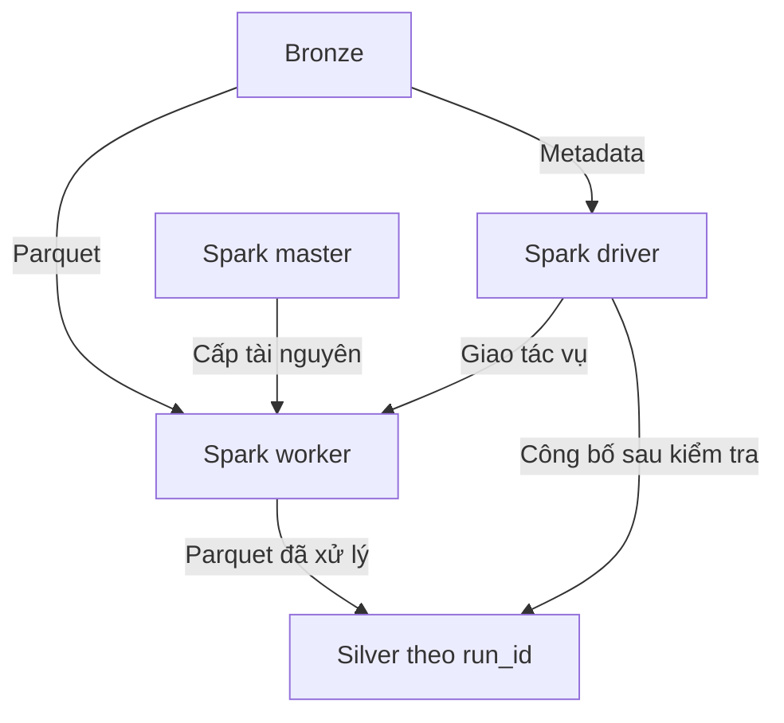

# Pipeline tiếp theo: Bronze → Silver bằng Spark

Bạn đã có DP1 đưa dữ liệu vào `bronze/smoke_v1`. Bây giờ viết và chạy job Spark
để biến dữ liệu đó thành các bảng Silver đã được kiểm tra. Trong gói này,
job tên `spark_jobs/dp2_bronze_to_silver.py`.

Đây là **phần Silver của DP2**, chưa phải toàn bộ DP2 trong rubric. Sau bước này
còn xây Gold, nối các job bằng Airflow, tích hợp catalog/lakehouse và DataHub.
Bảng Silver hiện ghi Parquet và có manifest công bố snapshot. Chưa gọi chúng
là bảng Iceberg, chưa có ACID/time travel/compaction của Iceberg.

## 1. Kết quả bạn cần đạt

| Bảng đầu ra | Grain | Số dòng với profile smoke mặc định |
|---|---|---:|
| `stg_customers` | Một khách hàng, ảnh chụp lúc đăng ký | 2.000 |
| `stg_products` | Một sản phẩm | 1.000 |
| `stg_orders` | Một đơn hàng | 12.000 |
| `stg_order_items` | Một dòng hàng duy nhất theo `order_item_id` | 29.980 |
| `stg_payments` | Một lần thử thanh toán | 13.523 |
| `stg_customer_changes` | Một sự kiện thay đổi khách hàng | 2.150 |
| `stg_customer_history` | Một phiên bản thuộc tính của khách hàng | 2.150 |

Nguồn có 30.591 dòng `order_items`, gồm 611 bản retry dư. Silver phải giữ 29.980
dòng duy nhất. Nếu bạn đã sửa config generator, dùng số của manifest bộ nguồn
tương ứng, không ép kết quả về bảng mẫu này.

## 2. Các thành phần mới và nhiệm vụ

| Thành phần | Nhiệm vụ |
|---|---|
| Spark master | Phân bổ tài nguyên cho ứng dụng |
| Spark worker | Chạy executor thực hiện đọc, join, window, ghi Parquet |
| Spark driver (`spark-job`) | Lập kế hoạch tính toán, kiểm tra kết quả và công bố snapshot |
| Spark History Server | Xem jobs/stages/SQL sau khi ứng dụng kết thúc |
| MinIO/Silo | Giữ Bronze, Silver, báo cáo và marker |



Compose cấu hình một master, một worker 2 core/2GB và driver 1GB. Đây là cluster
lab nhỏ, chưa phải cấu hình chạy benchmark nguồn 100GB. Dành khoảng 6–8GB RAM
cho Docker Desktop nếu máy đáp ứng, chừa thêm RAM cho Windows/VS Code. Dữ liệu
nguồn, Bronze, Silver và shuffle cần dung lượng đĩa riêng; không chỉ tính 100GB.

## 3. Cập nhật project đang dùng

Giải nén ZIP mới vào thư mục tạm, rồi chép các nội dung sau vào project đang
chứa `compose.yaml`:

- `compose.spark.yaml`.
- Thư mục `spark_jobs/`.
- Thư mục `infra/spark/`.
- Thư mục `tests_spark/`.
- File `tests/test_bronze_pipeline.py` nếu project của bạn chưa có.
- Tài liệu `docs/pipeline_02_silver.md`.

Giữ nguyên các thư mục `edai_generator/`, `pipelines/`, `tests/` và dữ liệu
hiện có. Dockerfile Spark cần chúng cho phần kiểm thử. Không xóa `output/`,
không thay credentials đang dùng và không tạo lại các volume storage.

Mở PowerShell ở đúng thư mục project:

```powershell
cd D:\edai-lab\synthetic_generator
Test-Path .\compose.yaml
Test-Path .\compose.spark.yaml
Test-Path .\spark_jobs\dp2_bronze_to_silver.py
```

Ba kết quả phải là `True`. Thay đường dẫn Windows nếu bạn đặt project nơi khác.
Các lệnh sau dùng **hai file Compose cùng lúc**. File gốc giữ storage đang chạy;
file overlay bổ sung Spark vào cùng network. Không chạy riêng `compose.spark.yaml`.

Nếu đang dùng `compose.addon.yaml` với stack nền móng khác, overlay này chưa
cấu hình cho network đó. Dùng cách kết nối network/credentials tương ứng của
stack nền móng; hướng dẫn bên dưới dành cho `compose.yaml` của gói generator.

## 4. Kiểm tra Bronze đã xong

Mở `http://localhost:9011`, vào bucket `bronze` → `smoke_v1`. Phải có:

- `_SUCCESS.json`: marker của DP1.
- `_runs/<run_id>/ingestion_report.json` và `ingest_ledger.jsonl`.
- `_runs/<run_id>/source_file_index.jsonl`.
- `source_files/` chứa sáu bảng nguồn.

Nếu chưa có, hoàn thành [DP1](pipeline_01_bronze.md). DP2 đọc đúng các file từ
ledger Bronze, không đọc trực tiếp `source-department` hay thư mục generator
để bỏ qua bước ingest.

## 5. Build image Spark

```powershell
docker compose -f compose.yaml -f compose.spark.yaml build spark-job
```

Build lần đầu cần Internet. Image gồm Apache Spark **3.5.6**, Java **17**,
Hadoop **3.3.4**, thư viện `boto3` và connector S3A đã khớp phiên bản.

`infra/spark/fetch_jars.py` tải `hadoop-aws:3.3.4` và
`aws-java-sdk-bundle:1.12.262` từ Maven Central, kiểm SHA256 trước khi sử dụng.
Không thêm các JAR Hadoop/AWS phiên bản ngẫu nhiên vào image vì dễ gây lỗi
`ClassNotFoundException` hoặc `NoSuchMethodError`.

Bạn không cần cài Java, PySpark hoặc pip trên Python Windows/uv đang dùng.

## 6. Bật cluster và mở các UI

```powershell
docker compose -f compose.yaml -f compose.spark.yaml up -d minio spark-master spark-worker spark-history
docker compose -f compose.yaml -f compose.spark.yaml ps
```

| Giao diện | URL | Cần kiểm tra |
|---|---|---|
| Storage | `http://localhost:9011` | Bronze tồn tại |
| Spark master | `http://localhost:8090` | Có 1 worker ALIVE, 2 core |
| Spark worker | `http://localhost:8091` | Thông tin worker và executor |
| Spark History Server | `http://localhost:18081` | Ban đầu có thể chưa có ứng dụng |
| Ứng dụng đang chạy | `http://localhost:4041` | Chỉ có khi driver đang chạy |

Worker có thể mất vài giây để đăng ký với master. Nếu UI chưa sẵn sàng, xem log:

```powershell
docker compose -f compose.yaml -f compose.spark.yaml logs --tail 80 spark-master spark-worker
```

## 7. Chạy job Bronze → Silver

Dán nguyên dòng dưới vào PowerShell:

```powershell
docker compose -f compose.yaml -f compose.spark.yaml run --rm --name edai-silver-job --service-ports spark-job --bronze-version smoke_v1 --silver-version smoke_v1 --out /data/silver/smoke_v1
```

| Tham số | Ý nghĩa |
|---|---|
| `--name edai-silver-job` | Tên mạng để executor gọi lại driver; phải khớp cấu hình |
| `--service-ports` | Mở cổng 4041 để xem UI ứng dụng đang chạy |
| `--bronze-version smoke_v1` | Đọc snapshot trong bucket `bronze` |
| `--silver-version smoke_v1` | Tạo snapshot cùng tên trong bucket `silver` |
| `--out /data/silver/smoke_v1` | Báo cáo nằm ở `output\silver\smoke_v1` trên Windows |

Pipeline tự tạo bucket `silver` nếu chưa có. Nó chạy qua các giai đoạn:

1. Kiểm marker và checksum báo cáo/inventory Bronze, kiểm các file nguồn có đủ.
2. Đọc sáu bảng bằng schema tường minh, chuẩn hóa chuỗi, timestamp UTC và kiểu tiền.
3. Kiểm dữ liệu bắt buộc, khoảng giá trị và mã phân loại.
4. Dedup `order_items`, ghi sáu bảng `stg_` vào thư mục riêng của lần chạy.
5. Đối chiếu khóa ngoại, giá trị đơn hàng/thanh toán và mốc thời gian.
6. Tạo `stg_customer_history`, kiểm SCD2 và nối đơn hàng vào đúng phiên bản lịch sử.
7. Chỉ khi tất cả kiểm tra qua mới ghi `_SUCCESS.json` của cả bộ Silver.

Trong log sẽ có `[DP2] Processing ...`, sau cùng là JSON tóm tắt:

```json
{
  "passed": true,
  "status": "published",
  "bronze_version": "smoke_v1",
  "silver_version": "smoke_v1",
  "table_rows": {
    "stg_customers": 2000,
    "stg_products": 1000,
    "stg_orders": 12000,
    "stg_order_items": 29980,
    "stg_payments": 13523,
    "stg_customer_changes": 2150,
    "stg_customer_history": 2150
  }
}
```

Đây là kết quả kỳ vọng với profile smoke mặc định. Không dùng số này thay cho
báo cáo thực tế của dataset khác.

## 8. Kiểm tra dữ liệu và báo cáo

Trong UI storage, vào `silver` → `smoke_v1`. Ở cấp này có `_DATASET.json`,
`_SUCCESS.json` và `_runs/`. Mở `_SUCCESS.json` để biết run ID được công bố.

Bảy bảng nằm dưới:

```text
silver/smoke_v1/_runs/<run_id>/tables/
```

Báo cáo `silver_report.json` nằm cùng cấp với `tables/`. Mỗi bảng Spark cũng
có thể có file `_SUCCESS` không đuôi. File đó chỉ xác nhận một lần ghi bảng.
Marker bạn cần kiểm tra cho **toàn bộ pipeline** là
`silver/smoke_v1/_SUCCESS.json`.

Trong báo cáo, đọc:

- `passed`, `status`: có được công bố hay chưa.
- `tables.stg_order_items.removed_duplicates`: số bản retry đã loại.
- `quality_checks`: kết quả từng kiểm tra.
- `raw_items_amount_vnd`, `clean_items_amount_vnd`, `duplicate_amount_removed_vnd`:
  đối soát tiền trước/sau dedup.
- `spark`: application ID, master, shuffle partitions và AQE.
- `output_inventory`: danh sách object thuộc snapshot, byte và ETag.

Với bộ smoke đã kiểm thử bằng Spark local:

| Chỉ số | Kết quả |
|---|---:|
| Bản retry loại bỏ | 611 |
| Tổng `line_amount` trước dedup | 483.359.824.000 VNĐ |
| Tổng `line_amount` sau dedup | 474.731.499.000 VNĐ |
| Phần bị đếm dư đã loại | 8.628.325.000 VNĐ |
| Kiểm tra chất lượng thành công | 48 |

Các tổng này gồm **mọi trạng thái đơn hàng**, chưa phải doanh thu được ghi nhận.
Khi làm Gold, phải định nghĩa rõ trạng thái/điều kiện ghi nhận doanh thu.

Mở báo cáo mới nhất trên Windows:

```powershell
$silverReport = Get-ChildItem .\output\silver\smoke_v1 -Filter silver_report.json -Recurse | Sort-Object LastWriteTime -Descending | Select-Object -First 1
Get-Content $silverReport.FullName
```

Đọc mẫu Parquet và lịch sử khách 20 bằng Spark trong một container tạm:

```powershell
docker compose -f compose.yaml -f compose.spark.yaml run --rm --no-deps --entrypoint /opt/spark/bin/spark-submit spark-job --master "local[2]" /opt/app/spark_jobs/inspect_silver.py --silver-version smoke_v1 --customer-id 20
```

Storage phải đang chạy. Lệnh xem mẫu dùng Spark local trong container để đọc
snapshot đã công bố; job xử lý chính ở bước 7 sử dụng master/worker.

## 9. Hiểu ba phần xử lý quan trọng

### Dedup có quy tắc

```python
window = Window.partitionBy("_dataset_version", "order_item_id").orderBy(
    F.col("created_ts").desc(),
    F.col("_source_file").desc(),
)
clean = (
    raw.withColumn("_rn", F.row_number().over(window))
       .filter(F.col("_rn") == 1)
       .drop("_rn")
)
```

Một ID có nhiều bản retry: giữ timestamp mới nhất. Nếu cùng ID nhưng các cột
nghiệp vụ khác nhau, job chặn và đưa vào quarantine vì contract của generator
quy định retry phải giữ nguyên nghiệp vụ. Không chọn tùy ý bằng `dropDuplicates`.

### Schema payments v1/v2

Schema đọc luôn khai báo `failure_reason` là string nullable. Khi đọc file
Parquet v1 thiếu cột, giá trị được biểu diễn bằng NULL. V2 giữ giá trị hiện có.
Không yêu cầu mọi lần thanh toán thất bại đều có reason vì bản v1 chưa có cột này.

### Lịch sử khách hàng SCD2

`customers` là ảnh lúc đăng ký. Các lần đổi segment lấy từ `customer_changes`.
Sau khi sắp xếp theo `effective_ts`, bỏ update không đổi thuộc tính, dùng `lead`
để xác định mốc kết thúc phiên bản:

| customer_id | segment | valid_from_ts | valid_to_ts | is_current |
|---|---|---|---|---|
| Ví dụ | standard | t1 | t2 | false |
| Ví dụ | loyal | t2 | NULL | true |

Khoảng hiệu lực là **[bắt đầu, kết thúc)**: đơn xảy ra đúng t2 thuộc phiên bản
mới. `customer_sk` là hash ổn định từ version dataset, customer ID và timestamp
microsecond. Rerun không sinh khóa phụ thuộc thứ tự partition.

Các cột `_dataset_version`, `_source_file`, `_pipeline_run_id`, `_ingested_at`
giúp truy vết Silver. `_dataset_version` ở đây là phiên bản Silver; báo cáo
ghi riêng `bronze_version` và `bronze_run_id` của đầu vào.

## 10. Chạy lại và dữ liệu lỗi

Chạy lại đúng lệnh ở bước 7. Nếu version đã hoàn tất và dữ liệu/rule không đổi:

```json
{
  "passed": true,
  "status": "already_published"
}
```

Job kiểm lại inventory đầu ra, byte và ETag, rồi dùng snapshot đã có. Không
append thêm dòng hoặc tính lại các bảng. Đây là kiểm tra thay đổi object,
không phải tính lại SHA256 toàn bộ Silver mỗi lần rerun.

Nếu lần trước thất bại, lần mới ghi vào run ID mới. Những file của lần hỏng
chưa được công bố có thể còn trong `_runs/`; chúng không thuộc snapshot thành
công. **Không đọc glob qua tất cả `_runs/*/tables`**, vì sẽ đếm cả các lần thử.
Gold phải đọc đường dẫn bảng do `_SUCCESS.json` chỉ ra.

Nếu có lỗi nghiệp vụ, job lưu Parquet dưới
`_runs/<run_id>/quarantine/<tên kiểm tra>/`, thêm `_dq_reason`, ghi báo cáo lỗi
và exit khác 0. Chính sách hiện tại là chặn snapshot khi có lỗi ngoài dự kiến.
Không âm thầm loại lỗi rồi báo thành công. Dòng retry hợp lệ là trường hợp được
xử lý riêng, không được tính là quarantine.

Nếu đổi bộ nguồn hoặc sửa logic pipeline, chọn version mới, ví dụ
`--silver-version smoke_v2`. Một version gắn với fingerprint của nguồn và code.
Mỗi version chỉ chạy một writer. Giữ Bronze bất biến sau khi DP1 công bố.

## 11. Đọc code theo thứ tự

| File/hàm | Điều cần học |
|---|---|
| `dp2_bronze_to_silver.py: main` | Nhận tham số và tạo các kết nối |
| `snapshot_store.py: inspect_bronze` | Đọc control files, kiểm dữ liệu đầu vào đã được công bố |
| `silver_contracts.py` | Schema, trường bắt buộc, kiểu dữ liệu, domain/range |
| `silver_transforms.py: transform_snapshot` | Thứ tự xử lý các bảng và đối soát |
| `deduplicate_items` | Window function và quy tắc giữ bản mới |
| `build_customer_history` | Lag/lead, bỏ no-op, tạo khoảng hiệu lực và surrogate key |
| `QualityGate` | Lưu dữ liệu lỗi, fail job khi validation không qua |
| Cuối `run_pipeline` | Tạo báo cáo rồi công bố marker sau cùng |

Các phép xử lý chính là Spark DataFrame/SQL, không dùng `toPandas()` hay
`collect()` cả dataset trong job. Driver chỉ nhận thống kê tổng hợp và metadata.
Kiểm tra nhiều lần, join, distinct và window đều có chi phí I/O/shuffle. Với
100GB phải đo lại task time, shuffle, spill và số file, rồi tối ưu trên workload
cụ thể. AQE hiện bật để chạy lab; chưa phải bài benchmark baseline-vs-optimized.

## 12. Spark UI và bằng chứng bài lab

Trong lúc job chạy, mở `http://localhost:4041`. Nếu chạy quá nhanh, mở
`http://localhost:18081` sau khi job xong và chọn application ID trong báo cáo.
History Server có thể cần vài giây để đọc event log.

Chụp các màn hình có ích:

1. Master: worker ALIVE và tài nguyên.
2. SQL: plan đọc Parquet, window dedup và join.
3. Stages: task duration, shuffle read/write và spill nếu có.
4. Storage: marker Silver và các bảng đúng run ID.
5. Báo cáo: số dòng trước/sau, removed_duplicates và validation PASS.

Không lấy thời gian kiểm thử local trong gói này làm số đo cluster của bạn.
Thí nghiệm skew phải có baseline, biến thể, cùng input và kết quả đối soát bằng
nhau; đó là một bước riêng sau khi logic đúng.

## 13. Lỗi thường gặp

| Lỗi | Cách kiểm tra |
|---|---|
| `no such service: spark-job` | Thiếu `-f compose.spark.yaml` hoặc đang ở sai thư mục |
| `No module named spark_jobs` | Chép đủ code, build lại image `spark-job` |
| `Initial job has not accepted any resources` | Master có worker ALIVE không; worker đủ RAM/core không |
| Executor không kết nối driver | Dùng `--name edai-silver-job`; kiểm `SPARK_DRIVER_HOST` và network |
| `S3AFileSystem` không tìm thấy | Kiểm build có chạy `fetch_jars.py` thành công |
| `NoSuchMethodError` Hadoop/AWS | Có JAR sai phiên bản; dùng image/pins đi kèm |
| `Missing ... _SUCCESS.json` | Bronze version sai hoặc DP1 chưa hoàn tất |
| Access denied/signature error | Credentials trong các container phải trùng storage |
| UI 4041 không mở sau job | Driver đã kết thúc; xem History Server 18081 |
| Spark History chưa có app | Kiểm event log volume, chờ đọc log, xem logs `spark-history` |
| Silver version có input/rules khác | Dùng version mới, không ghi đè snapshot đã công bố |
| `No space left`/executor OOM | Kiểm đĩa Docker, RAM, shard size và shuffle; quay về smoke trước |

Không dùng `down -v` để sửa lỗi job vì có thể xóa dữ liệu của lab.

## 14. Phạm vi kiểm thử

Đã chạy **7 test bằng Spark 3.5.6 thật, Java 17, chế độ local[2]**, trên bộ smoke
12.000 đơn. File Parquet được đọc/ghi thật. Kiểm tra gồm dedup, đối soát tiền,
schema v1/v2, SCD2 tại ranh giới thời gian, khóa ổn định khi đổi partition,
rerun không append, phát hiện file đã sửa, thiếu marker và quarantine chặn publish.

Trong các test, metadata S3 được mô phỏng và data nằm trên filesystem local.
Chưa chạy Docker daemon, cluster Docker hoặc S3A tới MinIO/Silo thật trong môi
trường bàn giao. Image tag/digest, dependency versions và SHA256 JAR đã kiểm tra.
Đây không phải kết quả chạy 100GB. Bước 5–8 là kiểm chứng trên môi trường của bạn.

Nếu sửa code và muốn chạy lại test nhỏ trong image:

```powershell
docker compose -f compose.yaml -f compose.spark.yaml run --rm --no-deps --entrypoint /opt/spark/bin/spark-submit spark-job --master "local[2]" /opt/app/tests_spark/test_silver.py -v
```

Test tự sinh bộ nhỏ trong thư mục tạm, không sửa các bucket của lab.

## 15. Bước tiếp theo sau khi Silver thành công

Xây Gold với `dim_customer` từ lịch sử SCD2, `dim_product`, `dim_date`,
`fact_orders`, `fact_order_items`, `fact_payment_attempts`. Khi nối thanh toán
vào đơn hàng, cần xử lý nhiều payment attempts để tránh nhân số dòng.

Sau đó nối DP1, Silver và Gold bằng Airflow, thêm feature pipeline DP3 và
lineage/validation trên DataHub. Bước này chưa thay thế các yêu cầu đó của rubric.

Tham khảo kỹ thuật chính thức:

- [Spark 3.5.6 Standalone](https://spark.apache.org/docs/3.5.6/spark-standalone.html)
- [Spark 3.5.6 Parquet](https://spark.apache.org/docs/3.5.6/sql-data-sources-parquet.html)
- [Spark cloud storage integration](https://spark.apache.org/docs/3.5.6/cloud-integration.html)
- [Spark monitoring và History Server](https://spark.apache.org/docs/3.5.6/monitoring.html)
- [Hadoop 3.3.4 dependency POM](https://repo.maven.apache.org/maven2/org/apache/hadoop/hadoop-project/3.3.4/hadoop-project-3.3.4.pom)
