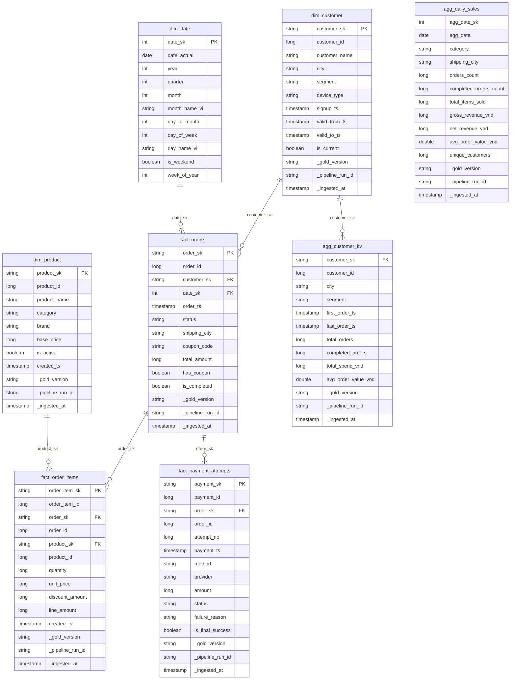

# Pipeline 03 – Gold Layer (Silver → Gold)

> **Kiến trúc Medallion**: Bronze (raw) → Silver (clean) → **Gold (star schema)**

---

## Tổng quan

DP3 (`dp3_silver_to_gold.py`) đọc bảy bảng Silver đã được validate, xây dựng **Star Schema** gồm 3 dimension, 3 fact và 2 aggregation table, rồi công bố Gold snapshot với cơ chế idempotency tương tự DP1/DP2.

---

## Star Schema



---

## Mô tả các bảng

### Dimension Tables

| Bảng | Grain | Mô tả |
|------|-------|-------|
| `dim_customer` | 1 hàng/khách hàng | Snapshot hiện tại (`is_current=True`) từ SCD2. Surrogate key giữ nguyên từ Silver. |
| `dim_product` | 1 hàng/sản phẩm | Toàn bộ sản phẩm. Surrogate key = sha256(gold_version + product_id). |
| `dim_date` | 1 hàng/ngày | Sinh tự động từ ngày min(order_ts) đến max(order_ts) + 30 ngày. Tên tháng/ngày tiếng Việt. |

### Fact Tables

| Bảng | Grain | Mô tả |
|------|-------|-------|
| `fact_orders` | 1 hàng/đơn hàng | Join SCD2 theo `order_ts` để tìm `customer_sk` đúng thời điểm. |
| `fact_order_items` | 1 hàng/dòng đơn hàng | FK đến `fact_orders` và `dim_product`. |
| `fact_payment_attempts` | 1 hàng/lần thanh toán | `is_final_success=True` cho lần `succeeded` với `attempt_no` cao nhất. |

### Aggregation Tables

| Bảng | Grain | Mô tả |
|------|-------|-------|
| `agg_daily_sales` | ngày × category × shipping_city | Tóm tắt kinh doanh hàng ngày. `net_revenue_vnd` chỉ tính đơn `completed`. |
| `agg_customer_ltv` | 1 hàng/khách hàng | Lifetime value: tổng chi tiêu, số đơn, v.v. `total_spend_vnd` chỉ tính đơn `completed`. |

---

## Surrogate Keys

Tất cả surrogate key được tạo bằng `sha256`:

```python
# fact_orders
order_sk = sha2(concat_ws(":", gold_version, order_id), 256)

# dim_product
product_sk = sha2(concat_ws(":", gold_version, product_id), 256)

# dim_customer: giữ nguyên customer_sk từ Silver (tạo bởi DP2)
customer_sk = sha2(concat_ws(":", silver_version, customer_id, unix_micros(valid_from_ts)), 256)
```

---

## Cách chạy trên Windows (Docker Compose)

### Yêu cầu

- Docker Desktop đã chạy
- MinIO đã có Silver snapshot (`--silver-version`)
- File `.env` với `AWS_ACCESS_KEY_ID`, `AWS_SECRET_ACCESS_KEY`

### Bước 1: Chạy DP2 (nếu chưa có Silver)

```powershell
docker compose -f compose.spark.yaml run --rm spark-submit `
  spark-submit `
  --master local[4] `
  /app/spark_jobs/dp2_bronze_to_silver.py `
  --bronze-version smoke_v1 `
  --silver-version smoke_v1
```

### Bước 2: Chạy DP3 (Silver → Gold)

```powershell
docker compose -f compose.spark.yaml run --rm spark-submit `
  spark-submit `
  --master local[4] `
  /app/spark_jobs/dp3_silver_to_gold.py `
  --silver-version smoke_v1 `
  --gold-version gold_v1 `
  --silver-bucket silver `
  --gold-bucket gold `
  --out /data/gold `
  --shuffle-partitions 8
```

### Bước 3: Inspect Gold

```powershell
docker compose -f compose.spark.yaml run --rm spark-submit `
  spark-submit `
  --master local[2] `
  /app/spark_jobs/inspect_gold.py `
  --gold-version gold_v1 `
  --gold-bucket gold `
  --customer-id 5
```

### Bước 4: Chạy tests (local, không cần Docker)

```powershell
cd d:\edai-synthetic-generator
python -m pytest tests_spark\test_gold.py -v --tb=short
```

---

## Số hàng kỳ vọng (Smoke Profile: 100 customers, 100 products, 800 orders)

| Bảng | Số hàng kỳ vọng | Ghi chú |
|------|-----------------|---------|
| `dim_customer` | 100 | Bằng số khách hàng, chỉ lấy is_current=True |
| `dim_product` | 100 | Bằng số sản phẩm |
| `dim_date` | ~60–90 | Phụ thuộc khoảng thời gian order + 30 ngày buffer |
| `fact_orders` | 800 | Bằng số đơn hàng |
| `fact_order_items` | ~760–780 | Sau dedup; xấp xỉ 800 (có thể ít hơn vì retry dedup) |
| `fact_payment_attempts` | ≥800 | Mỗi đơn ít nhất 1 lần thanh toán, một số có retry |
| `agg_daily_sales` | ~20–50 × số category × số city | Tùy phân phối ngày/category/city |
| `agg_customer_ltv` | ≤100 | Chỉ khách hàng có đơn hàng |

> [!NOTE]
> Tất cả giá trị tiền (VND) được lưu dưới dạng `long` (số nguyên), không dùng `decimal` hay `float`.

> [!TIP]
> Khi rerun với cùng `--gold-version`, pipeline sẽ trả về `status: already_published` mà không khởi động lại Spark — đây là hành vi idempotency được kiểm tra bằng `test_gold_rerun_idempotent`.

> [!IMPORTANT]
> Gold và Silver phải dùng **bucket riêng biệt**. Pipeline sẽ báo lỗi nếu cùng bucket.

---

## Cấu trúc file trên MinIO

```
gold/
└── gold_v1/
    ├── _DATASET.json          # Claim version (idempotency)
    ├── _SUCCESS.json          # Marker công bố (atomic write)
    └── _runs/
        └── 20261022T140000Z-abc123456789/
            ├── gold_report.json
            ├── tables/
            │   ├── dim_customer/
            │   ├── dim_product/
            │   ├── dim_date/
            │   ├── fact_orders/
            │   ├── fact_order_items/
            │   ├── fact_payment_attempts/
            │   ├── agg_daily_sales/
            │   └── agg_customer_ltv/
            └── quarantine/
                └── <check_name>/   # Chỉ tồn tại khi có lỗi DQ
```

---

## Quality Checks (DQ)

Pipeline thực hiện các kiểm tra sau theo thứ tự:

1. **dim_customer**: SK không null, customer_id > 0, is_current = true, không trùng SK
2. **dim_product**: Không trùng product_sk
3. **fact_orders**: SK không null, amount > 0, FK customer_sk và date_sk không orphan, không trùng SK
4. **fact_order_items**: SK không null, quantity > 0, line_amount > 0, FK order_sk và product_sk không orphan, không trùng SK
5. **fact_payment_attempts**: SK không null, amount > 0, FK order_sk không orphan, không trùng SK

Nếu bất kỳ check nào thất bại, toàn bộ pipeline dừng và `_SUCCESS.json` **không** được ghi.

