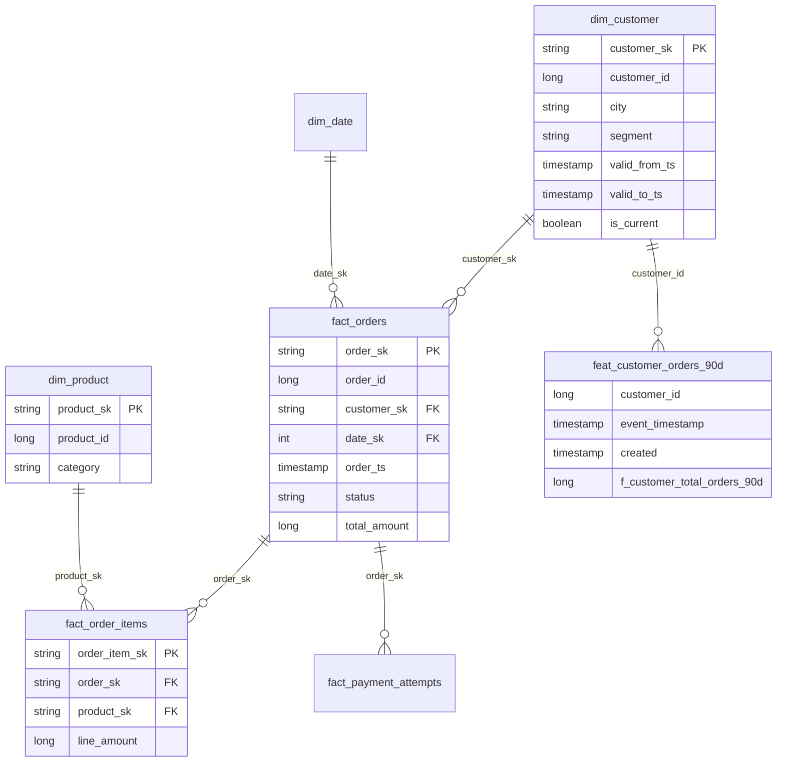

# Thiết kế schema, quan hệ bảng và quy ước đặt tên

## Các zone và bảng

| Zone | Bucket/đường dẫn | Bảng | Nhiệm vụ |
|---|---|---|---|
| Source | `source-department/synthetic/<profile>/` | `customers`, `products`, `orders`, `order_items`, `payments`, `customer_changes` | Parquet nguồn giả lập một phòng ban khác; chứa duplicate và schema v1/v2 |
| Bronze | `bronze/<version>/source_files/<bảng>/` | Bản sao nguyên trạng của 6 bảng nguồn (logic `raw_<bảng>`) | Lưu bản gốc không đổi, kèm ledger SHA256 và `_SUCCESS.json` |
| Silver | `silver/<version>/_runs/<run_id>/tables/` | `stg_customers`, `stg_products`, `stg_orders`, `stg_order_items`, `stg_payments`, `stg_customer_changes`, `stg_customer_history` | Chuẩn hóa kiểu, khử trùng `order_items`, tạo lịch sử SCD2 |
| Gold | `gold/<version>/_runs/<run_id>/tables/` | `dim_customer`, `dim_product`, `dim_date`, `fact_orders`, `fact_order_items`, `fact_payment_attempts`, `agg_daily_sales`, `agg_customer_ltv` | Star schema cho phân tích |
| Feature | `gold/_features/<version>/` | `feat_customer_orders_90d` | Feature offline cho ML (point-in-time) |

## Dim với SCD Type 2

`dim_customer` giữ **mọi phiên bản** của khách hàng với các cột `valid_from_ts`, `valid_to_ts` (NULL ở bản hiện tại) và `is_current`.
Mỗi `customer_id` có đúng một dòng `is_current = true` và các khoảng `[valid_from_ts, valid_to_ts)` liền nhau, không chồng, không hở
(kiểm tra bằng quality gate ở Silver và `dim_customer_one_current_per_customer` ở Gold). `fact_orders.customer_sk` trỏ tới phiên bản có hiệu lực tại `order_ts`
bằng range join, nên báo cáo lịch sử luôn dùng thuộc tính đúng thời điểm đặt hàng.

## Bảng feature `feat_`

`feat_customer_orders_90d` có khóa `(customer_id, event_timestamp)` và hai cột thời gian theo quy ước feature store:

| Cột | Ý nghĩa |
|---|---|
| `event_timestamp` | Mốc "as of" của feature; chỉ dùng dữ liệu có `order_ts <= event_timestamp` |
| `created` | Thời điểm pipeline tạo hàng |
| `f_customer_total_orders_90d` và các `f_customer_*` | Feature đếm, chi tiêu, giá trị đơn trung bình, số ngày từ đơn gần nhất |

Chi tiết cột và quality check: [pipeline_06_features.md](pipeline_06_features.md).

## Quan hệ giữa dim và fact (ERD)

Sơ đồ chỉ liệt kê cột chính. Danh sách cột đầy đủ do quality gate FK ở `spark_jobs/gold_contracts.py` kiểm tra: mỗi FK phải khớp một khóa của dim.
Ảnh quan hệ từ công cụ ngoài (ví dụ DBeaver) lấy từ PostgreSQL warehouse sau khi nạp (xem [data_storage.md](data_storage.md)):
**DBeaver → bấm phải vào schema `public` → View Diagram**, chụp và đặt ảnh dưới đây.

<!--  -->

## Quy ước đặt tên

| Zone | Tiền tố/quy ước | Ví dụ |
|---|---|---|
| Bronze | giữ tên bảng nguồn dưới `source_files/`; về logic là bảng `raw_*` (bản sao không biến đổi) | `source_files/orders` ≙ `raw_orders` |
| Silver | `stg_` | `stg_orders`, `stg_customer_history` |
| Gold (dimension) | `dim_` | `dim_customer`, `dim_product`, `dim_date` |
| Gold (fact) | `fact_` | `fact_orders`, `fact_order_items` |
| Gold (tổng hợp) | `agg_` | `agg_daily_sales`, `agg_customer_ltv` |
| Feature | `feat_` (cột feature `f_<thực thể>_<ý nghĩa>_<cửa sổ>`) | `feat_customer_orders_90d`, `f_customer_total_orders_90d` |
| Khóa | `*_sk` surrogate (sha256), `*_id` khóa nghiệp vụ | `customer_sk`, `customer_id` |
| Cột kỹ thuật | `_` đầu tên | `_pipeline_run_id`, `_gold_version`, `_ingested_at` |
| Thời gian | hậu tố `_ts` | `order_ts`, `valid_from_ts` |

Lưu ý: tên thư mục Bronze hiện chưa có tiền tố `raw_` trên đĩa; nếu giảng viên yêu cầu tên vật lý, cần đổi tên đường dẫn trong `pipelines/dp1_source_to_bronze.py`
và các job đọc Bronze.

## Ảnh các bảng và quan hệ trên mỗi zone (cần chụp sau khi chạy)

1. Bronze: MinIO Console → bucket `bronze` → `<version>/source_files/`.
2. Silver: MinIO Console → bucket `silver` → `<version>/_runs/<run_id>/tables/` (các thư mục `stg_*`); hoặc chạy `inspect_silver.py`.
3. Gold: MinIO Console → bucket `gold` → `<version>/_runs/<run_id>/tables/`; chạy `inspect_gold.py` để in schema.
4. ERD: ảnh DBeaver từ warehouse như trên.
